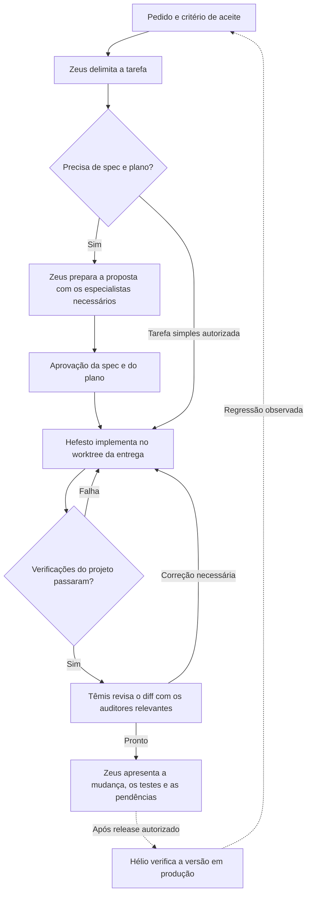

# Forja de Olimpo

A Forja de Olimpo coordena especialistas para transformar uma demanda de engenharia em uma mudança de código revisada, com resultados de testes e riscos identificados. Você conversa com **Zeus**, informa o repositório e descreve o comportamento esperado. Zeus acompanha a entrega e seleciona, entre 15 especialistas, quem precisa participar.

## Comece com uma tarefa

1. Tenha o Orca instalado e o Codex autenticado no computador que executará o bot. Clone este repositório ou extraia o ZIP obtido em **Code → Download ZIP**.
2. No Orca, abra **Bots → + → Import from another app… → Another app…**. Selecione a pasta que contém `SOUL.md` e `skills/`.
3. Dê ao bot o nome **Forja de Olimpo**, confira o computador e o agente selecionados e crie o bot. Revise o plano de importação no chat e confirme a persona e a habilidade **conduzir-entrega**. [Guia de importação do Orca](https://orca.dev/docs/bots/import)
4. Na primeira conversa, dê uma demanda com um critério que possa ser testado. Por exemplo:

> No repositório do app, investigue por que uma foto enviada offline aparece duas vezes após a reconexão. A entrega está pronta quando um teste reproduzir duas tentativas de sincronização e confirmar que apenas uma foto aparece. Comece pelo diagnóstico e apresente o plano antes de editar.

Nesse exemplo, **Quíron** reproduz a falha. Se a evidência apontar para a fila de sincronização, **Hefesto** recebe o cenário e o critério de aceite para implementar a correção. **Ártemis** verifica se o teste detecta a duplicação e **Têmis** revisa o diff. Uma mudança restrita à fila pode dispensar Figma, simulador e revisão visual.

## Como uma mudança percorre a Forja

**O que passa de uma sessão para outra.** Zeus entrega ao worker a pergunta, o SHA base ou diff, os arquivos relevantes, os limites de escrita e a evidência esperada. O worker devolve um resultado verificável, como um teste que falhou, um trecho em arquivo e linha ou uma captura associada a uma build. Ao retomar a entrega, Zeus confere a revisão e a última tarefa concluída.

**Quem pode trabalhar em paralelo.** Hefesto concentra as alterações de código e testes, uma tarefa por vez. Duas leituras independentes podem ocorrer em paralelo sobre a mesma revisão. Uma terceira exige ganho concreto e recursos isolados. Em testes concorrentes, cada execução precisa de simulador, banco, porta ou fila próprios quando houver disputa pelo mesmo recurso.

**Como a entrega reage a falhas.** Um gate obrigatório que falha devolve a tarefa a Hefesto. Uma correção posterior exige repetir as verificações afetadas. Se um despacho expirar, Zeus consulta as sessões existentes antes de repetir. Se uma operação externa tiver resultado incerto, consulta o estado pelo SHA, PR/MR ou versão. Commit, push, abertura de PR/MR, escrita no Jira e release seguem as autorizações do pedido.

## Papéis e escolha de modelo

| Etapa | Papéis | Resultado esperado |
| --- | --- | --- |
| Coordenação | **Zeus** conduz a conversa e mantém o plano | Escopo, decisão pendente e estado da entrega |
| Descoberta | **Hermes** localiza código e **Íris** lê o design | Arquivos, chamadores, componentes e estados relevantes |
| Decisão | **Atena** compara abordagens e **Prometeu** revisa spec e plano | Alternativa recomendada, riscos e critérios verificáveis |
| Diagnóstico e implementação | **Quíron** isola a falha e **Hefesto** implementa | Reprodução, diff e testes executados |
| Validação no app | **Argos** exercita o fluxo e **Afrodite** compara a tela ao design | Evidência identificada por build, estado e ambiente |
| Revisão | **Têmis** revisa o diff, **Ártemis** audita testes e **Clio** confere documentação | Achados vinculados à revisão analisada |
| Risco específico | **Cérbero** revisa segurança e **Atalanta** investiga performance | Mitigações e medições ligadas ao caminho alterado |
| Pós-release e manutenção | **Hélio** examina telemetria por versão e **Cronos** acompanha dependências | Regressões observadas e atualizações que merecem análise |

O template recomenda **Luna/low** para buscas e comparações localizadas, **Sol/medium** para implementação e validação, **Sol/high** para arquitetura, revisão e concorrência, e **Astra/high** para planejamento delegado complexo ou risco material. As escolhas orientam cada despacho. A disponibilidade depende do provedor e da conta usada no Orca. O catálogo especifica o modelo, o esforço e o critério de escalada de cada papel. [Catálogo e regras de despacho](skills/conduzir-entrega/SKILL.md)

## Como adaptar ao seu time

- Edite a [persona de Zeus](SOUL.md) para ajustar o idioma, os artefatos esperados e as ações que precisam de aprovação.
- Edite a [habilidade de condução](skills/conduzir-entrega/SKILL.md) para ajustar modelos, especialidades e verificações. Zeus deve conferir os scripts que existem no repositório da tarefa antes de executá-los.
- Conecte Jira, Figma ou telemetria conforme a demanda. Hélio precisa de uma versão identificada e acesso de leitura aos sinais de produção. Cronos pode rodar sob demanda ou por uma agenda que você configurar no Orca. [Bots e automações](https://orca.dev/docs/bots)
